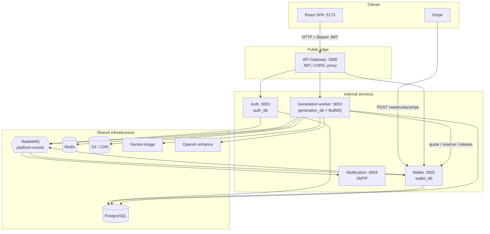
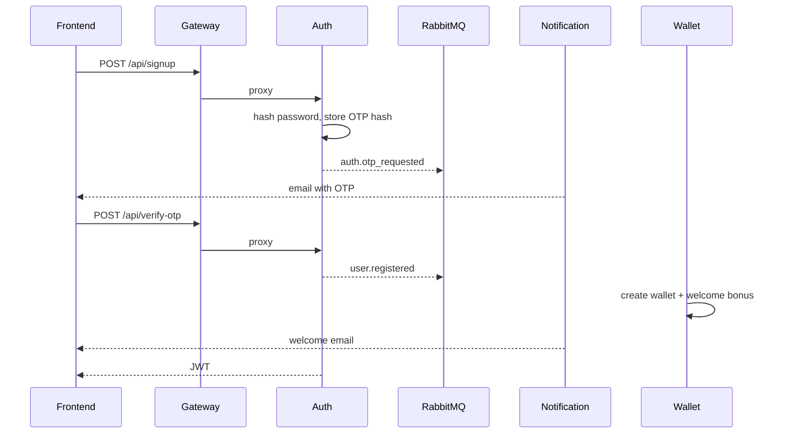
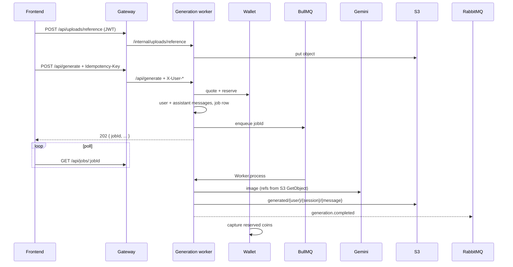
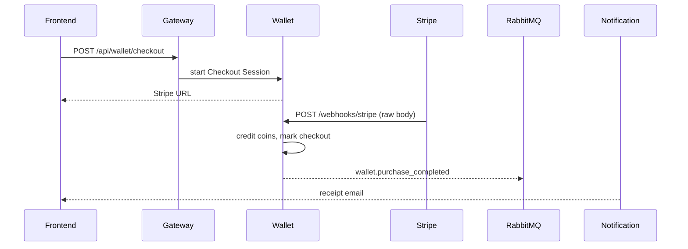

# Thumbcraft

Thumbcraft is a **pnpm + Turborepo** platform for generating YouTube-ready thumbnails with AI. Users work in **chat-style sessions**: they pick a model, set preferences, optionally enhance a prompt, attach reference images or gallery templates, then poll an async job until the image lands in S3.

This README describes the **current microservices architecture** (`apps/` + `packages/`). The older Express + MongoDB app under `backend/` is **legacy** and is not part of this design.

**Live demo:** [https://thumbcraft.abhisheknavgan.xyz/](https://thumbcraft.abhisheknavgan.xyz/)

---

## Contents

1. [What you get](#what-you-get)
2. [Architecture](#architecture)
3. [Design approaches](#design-approaches)
4. [Core flows](#core-flows)
5. [Project structure](#project-structure)
6. [Services](#services)
7. [Shared packages](#shared-packages)
8. [Local development](#local-development)
9. [Ports and infrastructure](#ports-and-infrastructure)
10. [Testing and evals](#testing-and-evals)
11. [Engineering plans](#engineering-plans)
12. [Deployment](#deployment)

---

## What you get

- **SPA frontend** (React 19, Vite, Tailwind, Zustand) talking only to the API gateway.
- **BFF-style API gateway** (Fastify) that verifies JWT, applies CORS / body limits, and proxies to internal services.
- **Auth** with email/password, hashed OTP, customer vs admin roles, JWT.
- **Wallet** with coin balances, Stripe Checkout packages, quote / reserve / capture / release.
- **Generation worker** that owns sessions, messages, jobs, Gemini image generation, OpenAI prompt enhance, S3, and BullMQ.
- **Notification service** that sends email from RabbitMQ events (OTP, welcome, purchase, generation).
- **Database per service** on PostgreSQL (Prisma), **RabbitMQ** for platform facts, **Redis** for the image queue.

---

## Architecture

The browser never calls auth, wallet, or the worker directly. The gateway is the public perimeter. Internal services trust `X-User-*` headers the gateway attaches after JWT verification. Stripe webhooks hit **wallet** on a raw-body path so the signature is not broken by JSON parsing.



### Runtime map

| Piece | Process | Database / broker | Public? |
|--------|---------|-------------------|---------|
| [frontend](apps/frontend/README.md) | Vite SPA | none | yes (static) |
| [api-gateway](apps/api-gateway/README.md) | Fastify | RabbitMQ (configured; not a consumer) | **yes** |
| [auth-service](apps/auth-service/README.md) | Fastify | `auth_db` + RabbitMQ publisher | no |
| [wallet-service](apps/wallet-service/README.md) | Fastify + consumer | `wallet_db` + RabbitMQ | webhook only |
| [generation-worker](apps/generation-worker/README.md) | Fastify + BullMQ worker | `generation_db` + Redis + RabbitMQ + S3 | no |
| [notification-service](apps/notification-service/README.md) | Fastify + consumer | SMTP (MailHog locally) | no |

---

## Design approaches

### 1. Gateway as the only public API

The SPA uses `VITE_API_BASE_URL` (default `http://localhost:3000`). The gateway:

- Verifies JWT (`jsonwebtoken` + shared `JWT_SECRET`).
- Forwards `Authorization`, `X-Correlation-Id`, and identity as `X-User-Id` / `Email` / `Name` / `Role`.
- Caps JSON (~2 MB) and multipart (~10 MB, one file).
- Aggregates `/health` from auth, wallet, and generation.

Auth, wallet, and generation **must stay private**. They authenticate callers via trusted headers, not by re-verifying JWT (auth-service still verifies JWT on `/api/profile` when called with a Bearer token).

### 2. Database per service

Locally one Postgres container hosts several databases (`infra/scripts/init-databases.sql`):

| Database | Owner |
|----------|--------|
| `auth_db` | users, OTP hashes |
| `wallet_db` | wallets, packages, transactions, checkout |
| `generation_db` | models, sessions, messages, jobs, gallery |
| `notification_db` | reserved; mailer is currently stateless |
| `generation_test` / `wallet_test` | Vitest (wiped; never mix with app data) |

There is **no distributed SQL transaction**. Billing is a **sequence with compensation**: HTTP reserve → work → RabbitMQ capture/release.

### 3. Two brokers on purpose

| Broker | Job |
|--------|-----|
| **BullMQ on Redis** | Image generation work: stable `jobId`, attempts, backoff, stall recovery, concurrency. |
| **RabbitMQ topic `platform.events`** | Facts: user registered, OTP requested, generation completed/failed, purchase completed/failed. |

Image jobs are not pushed through RabbitMQ (you would reimplement retries and visibility). Coin capture is not a BullMQ job (notification would have to speak Redis). See [Reliability](docs/03-reliability.md).

### 4. Conversation vs money

| Concept | Table | Role |
|---------|--------|------|
| Thread | `generation_sessions` | One iterative thumbnail chat |
| Chat bubble | `generation_messages` | User prompt + assistant image |
| Chargeable unit | `generation_jobs` | Wallet `jobId`; unique `idempotency_key` |

Postgres is the source of truth for chat and jobs. Redis is only the queue. Events are not a second copy of the conversation. Detail: [generation schema](apps/generation-worker/prisma/SCHEMA.md) and [data plan](docs/02-data-and-conversation-state.md).

### 5. Async generate, poll for status

`POST /api/generate` validates, writes messages, **reserves coins**, enqueues BullMQ, returns **202** with the job id. The UI polls `GET /api/jobs/:jobId` (and session messages). Polling is the default because a thumbnail takes tens of seconds; WebSockets would add reconnects without changing correctness.

First turn assembles base prompt + preferences. Later turns send new user text against Gemini `previous_interaction_id` stored on the session — cheaper than resending the full transcript. Detail: [Context management](docs/context-management.md), [ADR 001](docs/decisions/001-provider-side-continuity.md).

### 6. Idempotent money

- Client sends `Idempotency-Key` on generate / enhance.
- Wallet unique keys: `reserve:` / `capture:` / `release:{jobId}`.
- Duplicate HTTP or duplicate events must not double-charge.

Default costs (wallet env): **5 coins** per generation, **1 coin** for prompt enhance, **50 coins** welcome bonus on `user.registered`.

### 7. Shared platform packages

Services do not copy event shapes or logger setup. Contracts live in [`packages/`](#shared-packages) and are built first (`turbo` `dependsOn: ["^build"]`).

---

## Core flows

### Signup, OTP, welcome coins



### Generate a thumbnail (happy path)



If enqueue fails after reserve, the worker **releases** coins on the HTTP path. Capture and release from events are handled by wallet’s `wallet.events` consumer.

### Buy coins



Stripe is **not** proxied through the gateway JSON parser.

---

## Project structure

```text
thumbcraft/
├── apps/                          # runnable services (see links below)
│   ├── api-gateway/
│   ├── auth-service/
│   ├── wallet-service/
│   ├── generation-worker/
│   ├── notification-service/
│   └── frontend/
├── packages/                      # shared libraries
│   ├── config/                    # Zod env loader
│   ├── errors/                    # AppError + error codes
│   ├── logger/                    # pino factory
│   ├── messaging-contract/        # routing keys, queues, payloads
│   └── rabbitmq-client/           # topic exchange client
├── docs/                          # product/ops plans (not feature dumps)
├── evals/                         # golden Gemini cases (manual, costs money)
├── infra/
│   ├── docker/Dockerfile.template
│   └── scripts/                   # DB init, RabbitMQ bootstrap, kill ports, eval pack
├── docker-compose.yml             # Postgres, RabbitMQ, Redis, MailHog
├── pnpm-workspace.yaml
├── turbo.json
└── backend/                       # LEGACY — ignore for this architecture
```

Workspace members: `apps/*` and `packages/*` (`pnpm-workspace.yaml`). Package manager: **pnpm 9.15**, Node **≥ 20.19**.

---

## Services

| Service | README | Default port | Responsibility |
|---------|--------|--------------|----------------|
| API gateway | [apps/api-gateway/README.md](apps/api-gateway/README.md) | 3000 | Public HTTP, JWT, reverse proxy |
| Auth | [apps/auth-service/README.md](apps/auth-service/README.md) | 3001 | Users, OTP, JWT, `user.registered` / `auth.otp_requested` |
| Wallet | [apps/wallet-service/README.md](apps/wallet-service/README.md) | 3002 | Coins, Stripe, billing saga consumer |
| Generation | [apps/generation-worker/README.md](apps/generation-worker/README.md) | 3003 | Chat, gallery, Gemini, S3, BullMQ |
| Notification | [apps/notification-service/README.md](apps/notification-service/README.md) | 3004 | Transactional email |
| Frontend | [apps/frontend/README.md](apps/frontend/README.md) | 5173 | Marketing + dashboard chat UI |

---

## Shared packages

Index: [packages/README.md](packages/README.md)

| Package | README |
|---------|--------|
| `@platform/config` | [packages/config/README.md](packages/config/README.md) |
| `@platform/errors` | [packages/errors/README.md](packages/errors/README.md) |
| `@platform/logger` | [packages/logger/README.md](packages/logger/README.md) |
| `@platform/messaging-contract` | [packages/messaging-contract/README.md](packages/messaging-contract/README.md) |
| `@platform/rabbitmq-client` | [packages/rabbitmq-client/README.md](packages/rabbitmq-client/README.md) |

---

## Local development

### Prerequisites

- Node.js ≥ 20.19
- pnpm 9.15 (`corepack enable`)
- Docker (Compose for Postgres, RabbitMQ, Redis, MailHog)

### 1. Install and start infrastructure

```bash
pnpm install
pnpm infra:up
```

`infra:up` is `docker compose up -d`. Wait until Postgres is healthy so databases from `init-databases.sql` exist.

Optional: `pnpm infra:bootstrap` asserts the RabbitMQ topic exchange / queues used in local bootstrap.

### 2. Environment files

Copy each service `.env.example` to `.env`:

- [apps/api-gateway/.env.example](apps/api-gateway/.env.example)
- [apps/auth-service/.env.example](apps/auth-service/.env.example)
- [apps/wallet-service/.env.example](apps/wallet-service/.env.example)
- [apps/generation-worker/.env.example](apps/generation-worker/.env.example)
- [apps/notification-service/.env.example](apps/notification-service/.env.example)
- [apps/frontend/.env.example](apps/frontend/.env.example)

Use the **same `JWT_SECRET`** on gateway and auth. For image work without paying Gemini, set `FAKE_IMAGE_GENERATION=true` on the worker. For real images you need `GEMINI_API_KEY` and S3 (`AWS_S3_BUCKET`, credentials or IAM). Prompt enhance needs `OPENAI_API_KEY`. Stripe keys can be test-mode stubs if you are not buying coins.

Local SMTP: point notification at MailHog (`MAIL_HOST=localhost`, `MAIL_PORT=1025`). UI: [http://localhost:8025](http://localhost:8025).

### 3. Migrate and seed

```bash
pnpm --filter @thumbcraft/auth-service db:migrate
pnpm --filter @thumbcraft/wallet-service db:migrate
pnpm --filter @thumbcraft/generation-worker db:migrate
pnpm --filter @thumbcraft/generation-worker db:seed:models
pnpm --filter @thumbcraft/generation-worker db:seed:categories
```

### 4. Run apps

```bash
pnpm dev
```

Turborepo runs `dev` for all `apps/*` in parallel (packages build first). Stop listeners with `pnpm dev:stop` if ports stick around.

Individual services:

```bash
pnpm --filter @thumbcraft/api-gateway dev
pnpm --filter frontend dev
```

### Root scripts

| Script | Purpose |
|--------|---------|
| `pnpm dev` | All apps, parallel |
| `pnpm build` / `typecheck` / `test` | Turbo pipelines |
| `pnpm test:prepare` | Ensure `generation_test` / `wallet_test` exist |
| `pnpm eval:golden` | Real Gemini golden set ([evals/README.md](evals/README.md)) |
| `pnpm eval:pack` | Zip a proof pack from the latest eval run |
| `pnpm infra:up` / `infra:down` | Compose |
| `pnpm infra:bootstrap` | RabbitMQ topology helper |

---

## Ports and infrastructure

| Port | What |
|------|------|
| 5173 | Frontend (Vite) |
| 3000 | API gateway |
| 3001 | Auth |
| 3002 | Wallet (and Stripe webhook) |
| 3003 | Generation worker |
| 3004 | Notification |
| 5432 | PostgreSQL (`thumbcraft` / `thumbcraft`) |
| 5672 / 15672 | RabbitMQ AMQP / management UI |
| 6379 | Redis |
| 1025 / 8025 | MailHog SMTP / UI |

Compose currently **does not** start the Node apps; they run on the host via `pnpm dev`. App Dockerfiles are templated under `infra/docker/` for later ECS work.

---

## Testing and evals

- **CI-style unit/integration:** Vitest in gateway, wallet, and generation-worker. Fakes avoid live Gemini. `pnpm test:prepare` then `pnpm test`.
- **Golden evals:** `pnpm eval:golden` — real provider calls, not CI. See [evals/README.md](evals/README.md).
- **Fake path:** `FAKE_IMAGE_GENERATION=true` exercises HTTP + billing + jobs without LLM spend.

---

## Engineering plans

How the product is meant to behave under load, failure, and ops — start at [docs/README.md](docs/README.md):

1. [Evaluation and testing](docs/01-evaluation-and-testing.md)
2. [Data and conversation state](docs/02-data-and-conversation-state.md)
3. [Context management](docs/context-management.md) — first vs later turn, interaction id, refs, evals
4. [Reliability](docs/03-reliability.md)
5. [Failure tolerance](docs/04-failure-tolerance.md) · [Failure modes (continuity)](docs/failure-modes.md)
6. [Observability](docs/05-observability.md)
7. [Cost and latency](docs/06-cost-and-latency.md)
8. [Security, guardrails, privacy](docs/07-security-guardrails-privacy.md)
9. [Load handling and scale](docs/08-load-handling-and-scale.md)
10. [Deployment (later)](docs/09-deployment-later.md) → [deploymentPlan.md](deploymentPlan.md)

Decisions: [ADR 001 — provider-side continuity](docs/decisions/001-provider-side-continuity.md).

---

## Deployment

Target topology is **AWS ECS (EC2 launch type)**, not Kubernetes: public ALB → gateway only; Service Connect for private DNS; Amazon MQ; ElastiCache Redis; RDS (database per service); S3 + CloudFront for the SPA and generated images. Full write-up: [deploymentPlan.md](deploymentPlan.md).

---

## License

MIT
