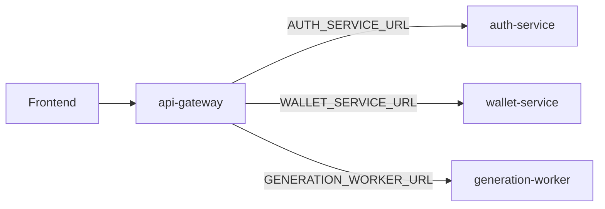

# API gateway

**Package:** `@thumbcraft/api-gateway`  
**Default port:** `3000`  
**Public:** yes — this is the only Node process the browser should call.

[← Root README](../../README.md)

The gateway is a Fastify **BFF / reverse proxy**. It does not own a database. It verifies JWT, attaches identity headers, proxies JSON and multipart, and reports downstream health.

---

## Approach

- **Perimeter, not business logic.** Signup, coins, generate, and S3 live in other services. The gateway maps `/api/*` to the right base URL.
- **JWT at the edge.** `requireAuth` / `requireAdmin` / `optionalAuth` use `JWT_SECRET` (must match [auth-service](../auth-service/README.md)).
- **Trusted identity downstream.** After verification, `buildDownstreamHeaders` sets `X-User-Id`, `X-User-Email`, `X-User-Name`, `X-User-Role`, plus `X-Correlation-Id` and optional `Authorization` / `Idempotency-Key`.
- **Do not proxy Stripe.** Webhooks need a raw body; they hit [wallet-service](../wallet-service/README.md) at `POST /webhooks/stripe`.
- **History routes are leftover.** `GET/DELETE /api/history` still proxy to the worker. Sessions + messages replaced that product surface — treat history as deprecated.



---

## Layout

```text
src/
├── index.ts              # listen, RabbitMQ connect (client present; no consumer)
├── app.ts                # Fastify plugins + route registration
├── config.ts             # Zod env
├── plugins/auth.ts       # JWT helpers
├── plugins/error-handler.ts
├── lib/http-client.ts    # proxyJson, health check, downstream headers
├── lib/multipart.ts      # rebuild multipart for worker uploads
└── routes/
    ├── health.ts
    ├── auth.ts
    ├── wallet.ts
    ├── models.ts
    ├── sessions.ts
    ├── gallery.ts
    ├── enhance.ts
    ├── generations.ts    # generate, jobs, messages, uploads
    └── history.ts        # deprecated proxy
```

---

## Public routes

Auth on the gateway unless noted.

| Method | Path | Downstream |
|--------|------|------------|
| GET | `/health` | Aggregates auth, wallet, generation `/health` |
| GET | `/ready` | Process up |
| POST | `/api/signup`, `/api/login`, `/api/verify-otp`, `/api/admin/register` | auth |
| GET | `/api/profile` | auth (JWT) |
| GET | `/api/wallet`, `/api/wallet/packages`, `/api/wallet/transactions` | wallet |
| GET | `/api/wallet/payments/:sessionId` | wallet |
| POST | `/api/wallet/quote`, `/reserve`, `/release`, `/checkout` | wallet |
| POST / PATCH | `/api/wallet/packages` | wallet, **admin** |
| GET / POST / PATCH / DELETE | `/api/models`, `/api/models/:id` | generation (mutations admin) |
| CRUD | `/api/sessions`, `/api/sessions/:id` | generation |
| GET | `/api/sessions/:sessionId/messages` | generation |
| GET | `/api/template-categories`, `/api/templates` | generation (optional JWT) |
| POST / PATCH / DELETE | gallery paths | generation, **admin** |
| POST | `/api/enhance-prompt` | generation (`Idempotency-Key` forwarded) |
| POST | `/api/generate` | generation (`Idempotency-Key` forwarded) |
| GET | `/api/jobs/:jobId` | generation |
| POST | `/api/uploads/reference` | `POST /internal/uploads/reference` |
| POST | `/api/uploads/template` | `POST /internal/uploads/template` (**admin**) |

---

## Configuration

See [`.env.example`](./.env.example).

| Variable | Role |
|----------|------|
| `PORT` | Listen (default 3000) |
| `AUTH_SERVICE_URL` | e.g. `http://localhost:3001` |
| `WALLET_SERVICE_URL` | e.g. `http://localhost:3002` |
| `GENERATION_WORKER_URL` | e.g. `http://localhost:3003` |
| `RABBITMQ_URL` | Required by config even though this process is not a consumer |
| `JWT_SECRET` | Min 16 chars; same as auth |

---

## Scripts

```bash
pnpm --filter @thumbcraft/api-gateway dev
pnpm --filter @thumbcraft/api-gateway test
pnpm --filter @thumbcraft/api-gateway typecheck
```

---

## Related

- [Frontend](../frontend/README.md) — only consumer of this API
- [Security plan](../../docs/07-security-guardrails-privacy.md) — rate limits / internal tokens still planned
