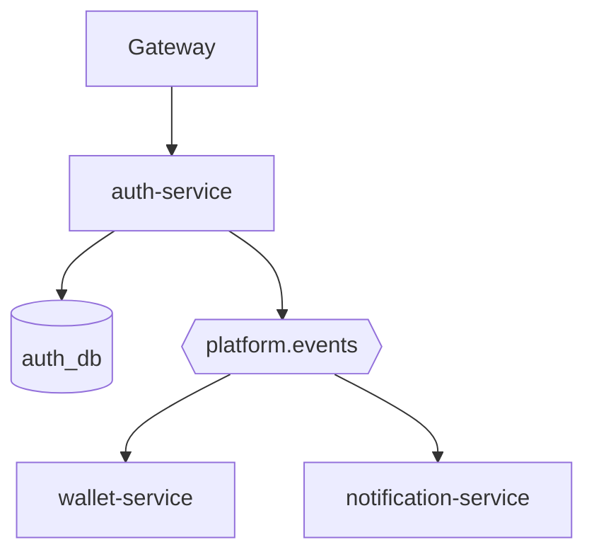
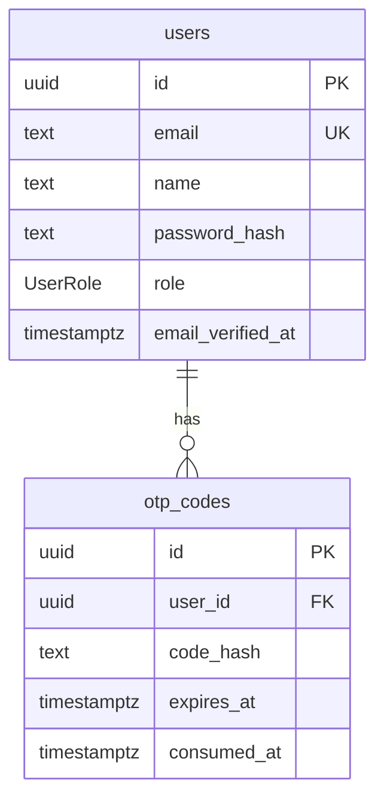

# Auth service

**Package:** `@thumbcraft/auth-service`  
**Default port:** `3001`  
**Database:** `auth_db` (Prisma)  
**Public:** no — reach it through the [API gateway](../api-gateway/README.md).

[← Root README](../../README.md)

Owns **identity only**: users, password hashes, OTP codes, JWT issuance. It does not store wallets or generation history. After signup/verify it **publishes events** so wallet can grant a welcome bonus and notification can send mail.

---

## Approach

- **Database per service.** `users` and `otp_codes` live here. Wallet creates a row on `user.registered` using the same `userId`.
- **OTP is hashed at rest.** The plaintext OTP is published on `auth.otp_requested` so the mailer can send it (see [security plan](../../docs/07-security-guardrails-privacy.md) for the leak tradeoff).
- **Roles.** `customer` (default) vs `admin`. Admin registration requires `ADMIN_INVITE_SECRET`.
- **Gateway vs local auth.** Gateway verifies JWT for most product APIs. This service still verifies Bearer JWT on `GET /api/profile`.
- **Events, not HTTP fan-out.** Auth does not call wallet or notification.



---

## Data model



Schema: [`prisma/schema.prisma`](./prisma/schema.prisma).

---

## HTTP API

| Method | Path | Notes |
|--------|------|--------|
| POST | `/api/signup` | 201; emits `auth.otp_requested` |
| POST | `/api/verify-otp` | Marks email verified; emits `user.registered`; returns JWT |
| POST | `/api/login` | Password check; returns JWT |
| POST | `/api/admin/register` | Invite secret; admin role |
| GET | `/api/profile` | Bearer JWT |
| GET | `/health`, `/ready` | Liveness / readiness |

---

## Events published

Defined in [`@platform/messaging-contract`](../../packages/messaging-contract/README.md).

| Routing key | When |
|-------------|------|
| `auth.otp_requested` | Signup (and similar OTP paths) |
| `user.registered` | Successful OTP verify |

---

## Layout

```text
src/
├── index.ts
├── config.ts
├── db/
├── plugins/auth.ts
├── routes/auth.ts
├── controllers/          # signup, login, verify-otp, admin-register, profile
└── services/             # user, otp, token
prisma/schema.prisma
```

---

## Configuration and scripts

[`.env.example`](./.env.example): `DATABASE_URL`, `JWT_SECRET`, `RABBITMQ_URL`, `ADMIN_INVITE_SECRET`, `PORT`.

```bash
pnpm --filter @thumbcraft/auth-service db:migrate
pnpm --filter @thumbcraft/auth-service dev
```

`JWT_SECRET` must match the gateway.

---

## Related

- [Wallet](../wallet-service/README.md) — welcome bonus consumer
- [Notification](../notification-service/README.md) — OTP and welcome email
