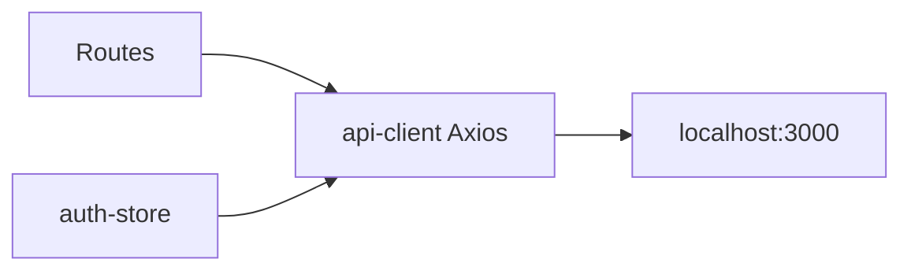

# Frontend

**Package:** `frontend`  
**Dev server:** Vite, default `http://localhost:5173`  
**API:** [API gateway](../api-gateway/README.md) only (`VITE_API_BASE_URL`).

[← Root README](../../README.md)

React 19 SPA for marketing, gallery browse, auth drawer, session chat, and wallet/profile. It does **not** talk to auth/wallet/worker ports.

---

## Approach

- **Single origin for APIs.** Axios client in `src/lib/api-client.ts` attaches Bearer JWT from storage and maps `AppError` codes for toasts.
- **Chat product, not a wizard-only form.** Routes under `/dashboard/sessions/:sessionId` poll jobs after `POST /api/generate` (202). Empty sessions bootstrap via `POST /api/sessions` (worker reuses an empty thread).
- **Zustand** for auth and chat client state; **Zod** for auth form schemas; **Radix / shadcn** UI.
- **Gallery** is public-ish (`optionalAuth` on gateway) so landing pages can show templates; generate still requires login.
- Legacy paths (`/generate`, `/wallet`) redirect into the dashboard.



---

## Routes

| Path | Page |
|------|------|
| `/` | Home / marketing |
| `/gallery/:categoryId` | Category templates |
| `/dashboard/new` | New chat |
| `/dashboard/sessions/:sessionId` | Session thread + composer |
| `/dashboard/profile` | Profile + wallet UI |
| `/dashboard/wallet/confirm` | Stripe return (`session_id` query) |

---

## Layout

```text
src/
├── app/                 # layouts, router
├── pages/
├── components/          # generation, wallet, home, auth, ui
├── stores/              # auth-store, chat-store
├── lib/                 # api-client, preference-catalog, auth-token
└── types/
```

---

## Configuration and scripts

[`.env.example`](./.env.example):

```bash
VITE_API_BASE_URL=http://localhost:3000
```

```bash
pnpm --filter frontend dev
pnpm --filter frontend build
pnpm --filter frontend lint
```

Production static files are intended for S3 + CloudFront; the browser still calls the public gateway / ALB. See [deploymentPlan.md](../../deploymentPlan.md).

---

## Related

- [API gateway](../api-gateway/README.md)
- [Generation worker](../generation-worker/README.md) — session/message/job contract
