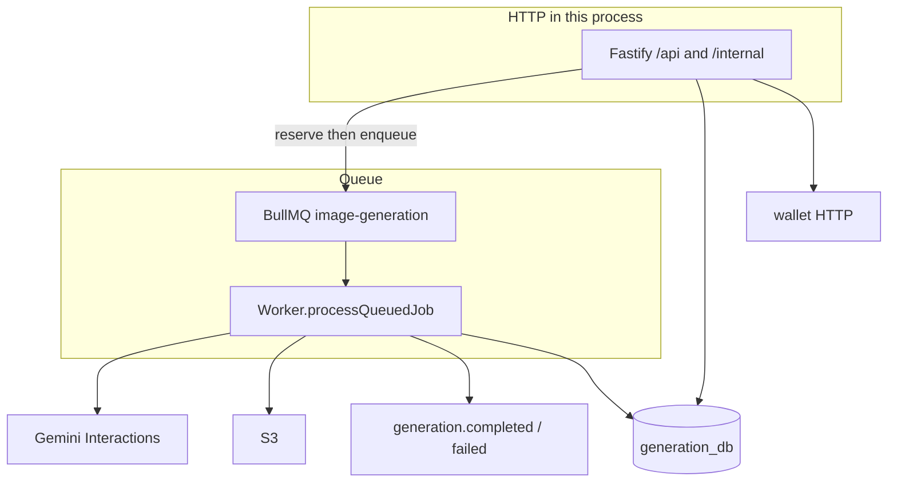

# Generation worker

**Package:** `@thumbcraft/generation-worker`  
**Default port:** `3003`  
**Database:** `generation_db`  
**Public:** no — HTTP is for the [API gateway](../api-gateway/README.md). Uploads use `/internal/*`.

[← Root README](../../README.md)

This is the **product core**: model catalog, gallery, sessions/messages, prompt enhance, Gemini image generation, S3, BullMQ, and publishing billing/notification events.

Today **one process** serves Fastify **and** the BullMQ worker. Under load those can split; they share the same database and Redis. See [load plan](../../docs/08-load-handling-and-scale.md).

---

## Approach

- **Sessions / messages / jobs are three tables.** Chat is not a job; a job is not a bubble. Wallet `jobId` is always `generation_jobs.id`. Full ERD: [prisma/SCHEMA.md](./prisma/SCHEMA.md).
- **HTTP generate returns 202.** Validate model + aspect/resolution → persist user + assistant messages → quote + reserve coins → enqueue BullMQ with the **same UUID** as the Prisma job. LLM runs in `processQueuedJob`.
- **Provider input is server-built.** The client sends prompt + preferences; the worker writes `providerInput` (first turn: assembled prefs; later turns: user text only + Gemini interaction id).
- **S3 GetObject for model refs.** Browser may use CDN URLs; Gemini must not depend on a world-readable bucket. Keys: [src/storage/README.md](./src/storage/README.md).
- **Fake mode.** `FAKE_IMAGE_GENERATION=true` skips Gemini and returns a placeholder URL so billing and polling can be tested.
- **Enhance** is a separate billed job (`kind=prompt_enhance`) on the **user** message; image jobs hang off the **assistant** message.



Job status: `created` → `reserved` → `processing` → `captured` | `released` | `failed`.

---

## Modules

```text
src/
├── index.ts                 # Prisma, RabbitMQ, Redis, Fastify, BullMQ worker
├── app.ts
├── modules/
│   ├── models/              # admin CRUD, visible catalog
│   ├── gallery/             # categories + templates
│   ├── sessions/
│   ├── messages/
│   ├── jobs/                # GET /api/jobs/:jobId
│   ├── enhance/             # OpenAI rewrite of typed text
│   ├── generate/            # 202 + processQueuedJob
│   ├── uploads/             # internal multipart → S3
│   └── health/
├── queue/                   # BullMQ queue + worker
├── providers/               # Gemini (image); OpenAI enhance / unused image adapter
├── prompts/                 # preference catalog + assemble
├── storage/                 # S3
└── lib/wallet-client.ts     # quote / reserve / release
```

---

## HTTP API (after gateway JWT → X-User-*)

| Area | Paths |
|------|--------|
| Health | `GET /health`, `GET /ready` |
| Models | `GET/POST /api/models`, `GET/PATCH/DELETE /api/models/:id` |
| Sessions | `POST/GET /api/sessions`, `GET/PATCH/DELETE /api/sessions/:id` |
| Messages | `GET /api/sessions/:sessionId/messages` |
| Enhance | `POST /api/enhance-prompt` |
| Generate | `POST /api/generate` → 202 |
| Jobs | `GET /api/jobs/:jobId` |
| Gallery | `/api/template-categories`, `/api/templates` |
| Uploads | `POST /internal/uploads/reference`, `/internal/uploads/template` |

`POST /api/sessions` **reuses** the oldest active session with zero messages so silent UI bootstrap does not create junk threads.

---

## Queue

- Queue name: `image-generation`
- Default: 3 attempts, exponential backoff from 2s, keep last 200 completed / 500 failed jobs in Redis
- Payload carries `jobId` (= Prisma id), user identity, `correlationId`
- Worker skips work if the job is already `captured` or the assistant message is `completed` (retry safety)

---

## Events published

| Routing key | When |
|-------------|------|
| `generation.completed` | Image or enhance succeeded (`kind` in payload) |
| `generation.failed` | Terminal failure after retries / non-retryable error |

Wallet captures/releases from these. Notification sends optional email if payload includes `email`.

---

## Configuration

[`.env.example`](./.env.example).

| Variable | Role |
|----------|------|
| `DATABASE_URL` | `generation_db` |
| `REDIS_URL` | BullMQ |
| `WALLET_SERVICE_URL` | Direct HTTP (not via gateway) |
| `GEMINI_API_KEY` | Image provider |
| `OPENAI_API_KEY` | Enhance; missing → `POST /api/enhance-prompt` is 503 |
| `AWS_S3_*` | Persistence; missing bucket disables uploads / generated files |
| `FAKE_IMAGE_GENERATION` | Skip real image LLM |

---

## Scripts

```bash
pnpm --filter @thumbcraft/generation-worker db:migrate
pnpm --filter @thumbcraft/generation-worker db:seed:models
pnpm --filter @thumbcraft/generation-worker db:seed:categories
pnpm --filter @thumbcraft/generation-worker dev
pnpm --filter @thumbcraft/generation-worker test
pnpm --filter @thumbcraft/generation-worker eval:golden
```

Seeds: models from `reference/Gemini-models.json`; categories/templates from seed scripts.

---

## Related

- [Wallet](../wallet-service/README.md)
- [Notification](../notification-service/README.md)
- [Evals](../../evals/README.md)
- [Data plan](../../docs/02-data-and-conversation-state.md)
