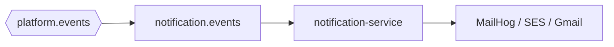

# Notification service

**Package:** `@thumbcraft/notification-service`  
**Default port:** `3004`  
**Public:** no  
**Storage:** no Prisma usage today (`.env` may still list `DATABASE_URL` for future mail logs).

[← Root README](../../README.md)

Transactional **email** only. It does not decide coins or job state. If SMTP fails, generation still succeeded — that is why this process is a separate RabbitMQ consumer ([failure tolerance](../../docs/04-failure-tolerance.md)).

---

## Approach

- **Consume facts, send mail.** One queue `notification.events` bound to several routing keys.
- **Nodemailer** + HTML templates under `src/templates/`.
- **Local MailHog** (`localhost:1025`, UI `:8025`) so OTP can be read without Gmail.
- Fastify exists for `/health` and `/ready` (and later probes), not for a public mail API.



---

## Events consumed

| Routing key | Email |
|-------------|--------|
| `auth.otp_requested` | OTP code |
| `user.registered` | Welcome |
| `wallet.purchase_completed` | Purchase receipt |
| `wallet.purchase_failed` | Purchase failed |
| `generation.completed` | Thumbnail ready (when payload has email) |
| `generation.failed` | Generation failed |

Contract: [`@platform/messaging-contract`](../../packages/messaging-contract/README.md).

---

## Layout

```text
src/
├── index.ts
├── config.ts
├── consumers/notification-events.consumer.ts
├── handlers/                 # one file per event
├── services/mail.service.ts
└── templates/
```

---

## Configuration and scripts

[`.env.example`](./.env.example): `RABBITMQ_URL`, `MAIL_HOST`, `MAIL_PORT`, `MAIL_USER`, `MAIL_PASSWORD`, `MAIL_FROM`.

```bash
pnpm --filter @thumbcraft/notification-service dev
```

For MailHog, empty user/password is typical; set `MAIL_HOST=localhost` and `MAIL_PORT=1025`.

---

## Related

- [Auth](../auth-service/README.md) — OTP + welcome
- [Wallet](../wallet-service/README.md) — purchase mail
- [Generation worker](../generation-worker/README.md) — job mail
