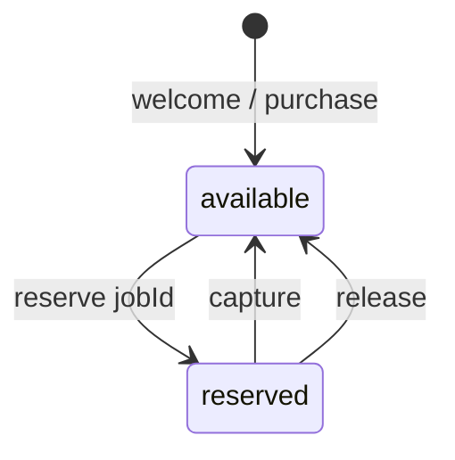
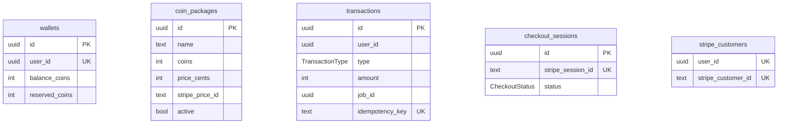

# Wallet service

**Package:** `@thumbcraft/wallet-service`  
**Default port:** `3002`  
**Database:** `wallet_db` (Prisma)  
**Public:** Stripe webhook only. Product APIs go through the [API gateway](../api-gateway/README.md).

[← Root README](../../README.md)

Owns **coins**: balances, reservations, Stripe Checkout packages, and the billing saga for generation jobs. Identity is a `userId` string from trusted headers — there is no FK to `auth_db`.

---

## Approach

- **Quote is sync HTTP** so the UI can show cost before confirm (`PROMPT_ENHANCE_COIN_COST`, `GENERATION_COIN_COST`).
- **Reserve is sync HTTP** (generation-worker calls wallet **directly**, not only via gateway) so unpaid work is never queued. Fail with insufficient funds (`INSUFFICIENT_FUNDS` / 402-class `AppError`).
- **Capture and release are event-driven** on `generation.completed` / `generation.failed`. Worker also has HTTP `POST /api/wallet/release` for compensation when enqueue fails before an event exists.
- **Idempotency** on `transactions.idempotency_key` (`reserve:` / `capture:` / `release:{jobId}`). Duplicate events are no-ops.
- **Welcome bonus** on `user.registered` (`WELCOME_BONUS_COINS`).
- **Stripe** creates Checkout Sessions; `POST /webhooks/stripe` uses a **raw body** parser. Do not send this through the gateway JSON stack.
- HTTP app is `createApp()`; the RabbitMQ consumer starts in `index.ts` so tests can skip the broker.



`balance_coins` is spendable. `reserved_coins` is held until capture (debit) or release (return to balance).

---

## Data model



Schema: [`prisma/schema.prisma`](./prisma/schema.prisma).

Transaction types: `welcome_bonus` | `purchase` | `reserve` | `capture` | `release`.

---

## HTTP API

All `/api/wallet/*` routes expect `X-User-*` (gateway or worker). Admin mutations need `X-User-Role: admin`.

| Method | Path | Purpose |
|--------|------|---------|
| GET | `/api/wallet` | Balance + reserved |
| POST | `/api/wallet/quote` | `{ kind: "generation" \| "prompt_enhance" }` → coin cost |
| POST | `/api/wallet/reserve` | Hold coins for `jobId` + `amount` |
| POST | `/api/wallet/release` | Compensate a reserve |
| GET | `/api/wallet/packages` | Catalog (admin sees inactive too) |
| POST / PATCH | `/api/wallet/packages` | Admin + Stripe product/price |
| POST | `/api/wallet/checkout` | Stripe Checkout URL |
| GET | `/api/wallet/payments/:sessionId` | Checkout status after return |
| GET | `/api/wallet/transactions` | Cursor list |
| POST | `/webhooks/stripe` | Signed Stripe events |
| GET | `/health`, `/ready` | |

---

## Events

**Consumes** (`wallet.events` queue):

| Routing key | Handler |
|-------------|---------|
| `user.registered` | Create wallet + welcome bonus |
| `generation.completed` | Capture reserve for `event.jobId` |
| `generation.failed` | Release reserve |

**Publishes:**

| Routing key | When |
|-------------|------|
| `wallet.purchase_completed` | Stripe payment succeeded |
| `wallet.purchase_failed` | Checkout/payment failed |

---

## Layout

```text
src/
├── index.ts                      # HTTP + consumer
├── app.ts                        # Fastify only
├── consumers/wallet-events.consumer.ts
├── handlers/                     # user-registered, generation-billing
├── controllers/                  # wallet, billing, package, checkout, transaction
├── services/
├── routes/wallet.ts
└── routes/webhook.ts
prisma/
```

---

## Configuration and scripts

[`.env.example`](./.env.example): `DATABASE_URL`, `RABBITMQ_URL`, Stripe keys and success/cancel URLs, coin amounts.

```bash
pnpm --filter @thumbcraft/wallet-service db:migrate
pnpm --filter @thumbcraft/wallet-service dev
pnpm --filter @thumbcraft/wallet-service test
```

Vitest uses `wallet_test` (`pnpm test:prepare` from the repo root).

---

## Related

- [Generation worker](../generation-worker/README.md) — quote/reserve/release client
- [Reliability](../../docs/03-reliability.md) — why there is no 2PC
